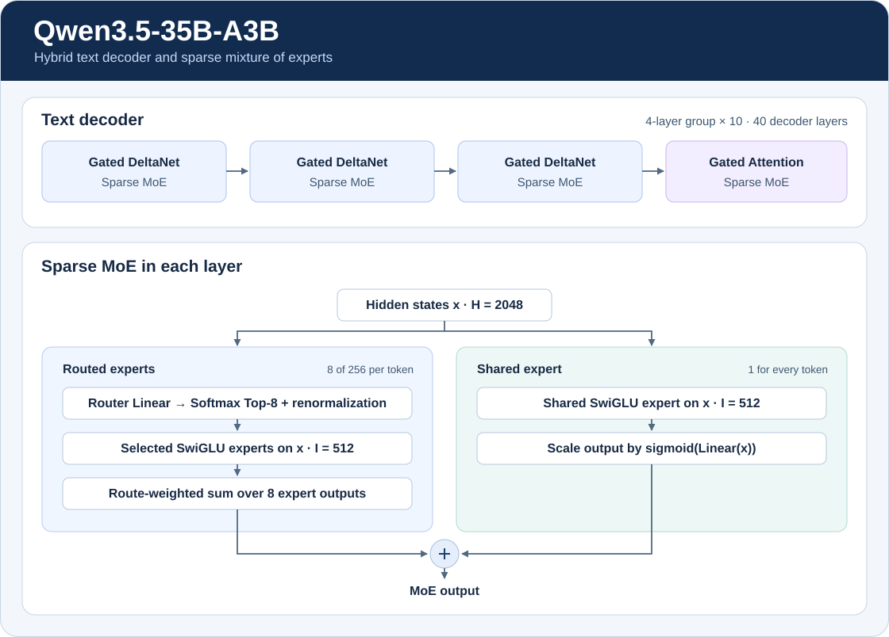

# MoE Kernel

用于单卡 NVIDIA GPU 推理的 Triton MoE 前向算子。支持从 router logits 完成专家路由与计算，也可直接使用已有路由结果。项目提供 vLLM 插件、PyTorch 数值对照和三层性能评测工具。

- [快速开始](#快速开始)
- [实现](#实现)
- [vLLM 集成](integrations/vllm/README.md)
- [测试与评测](#测试与评测)

## 快速开始

准备 Python 3.10 或更高版本、支持 CUDA 的 PyTorch 2.8 或更高版本，以及与该环境兼容的 Triton。在仓库根目录安装项目。

```bash
python -m pip install --no-deps --no-build-isolation .
```

以下示例使用随机权重和输入，可独立运行。

```python
import torch

from moe_kernel import MoEConfig, MoEWorkspace, moe

m, h, i, e, r = 8, 64, 32, 16, 4
device = torch.device("cuda")
dtype = torch.bfloat16
config = MoEConfig(hidden_dim=h, intermediate_dim=i, num_experts=e, top_k=r)

with torch.inference_mode():
    x = torch.randn(m, h, device=device, dtype=dtype)
    logits = torch.randn(m, e, device=device, dtype=dtype)
    w13 = torch.randn(e, 2 * i, h, device=device, dtype=dtype) / h**0.5
    w2 = torch.randn(e, h, i, device=device, dtype=dtype) / i**0.5

    workspace = MoEWorkspace()
    workspace.prepare(max_tokens=m, config=config, device=device, dtype=dtype)
    y = moe(x, logits, w13, w2, top_k=r,
            renormalize=config.renormalize, workspace=workspace)
    print(y.shape)  # torch.Size([8, 64])
```

| 参数或结果 | 形状 | 类型与含义 |
| --- | --- | --- |
| `x` | `[M, H]` | BF16 或 FP16 激活 |
| `logits` | `[M, E]` | 有限的 BF16 或 FP32 router logits |
| `w13` | `[E, 2I, H]` | 与激活同类型，前一半为 gate，后一半为 up |
| `w2` | `[E, H, I]` | 与激活同类型的 down projection |
| `topk_weights`、`topk_ids` | `[M, R]` | FP32 权重，INT32 或 INT64 专家 ID，ID 范围为 `[0, E)` |
| 输出或可选的 `out` | `[M, H]` | 与激活同类型 |

`M` 是实际批次 token 数，`H` 是隐藏维度，`I` 是单个专家的中间维度，`E` 是专家数，`R` 是每个 token 选择的专家数。张量须在同一 CUDA 设备且连续。已有路由时使用 `experts(x, w13, w2, topk_weights, topk_ids, workspace=workspace)`。两个入口都可提供独立的 `out` 缓冲区。

workspace 按最大 token 数、模型形状和 dtype 预分配，可在同一 CUDA stream 上顺序复用。多 stream 并行时使用独立 workspace 或同步访问。独立算子可预热并在 CUDA Graph 中捕获和重放，重放时保持形状及缓冲区地址，路由值可以变化。

## 实现

```text
Router logits → Softmax Top-K → 路由索引分组与对齐
                                      ↓
输入激活 ──────────────────────────→ GEMM1 → SwiGLU → GEMM2 并加权 → 沿 Top-K 求和
```

- Top-K 在同一 kernel 中将 logits 转为 FP32 计算并返回 FP32 路由权重。开启 `renormalize` 时，权重在所选专家内归一化。
- 按专家整理路由索引，并对齐到 GEMM 行块。GEMM1 通过路由编号读取输入激活，两次 GEMM 都按原始路由编号写回。GEMM grid 使用实际路由数及专家数计算行块上界，并由设备上的实际对齐长度限定计算范围。
- 两次 GEMM 共用间接寻址实现，采用 FP32 累加。GEMM2 写回前应用路由权重。SwiGLU 和最终归约采用 FP32 计算，阶段输出写为激活类型。
- 常规专家路径发射 9 次 kernel。单 token、Top-K ≤ 8 时跳过分组并直接访问专家，发射 4 次。Blackwell SM 12.0 上的 BF16 目标形状 `H=2048, I=512, E=256, R=8` 使用默认 `BM=16` workspace 时，`M=2–8` 走单次对齐，专家路径发射 5 次。该目标形状还在 `M≥96` 和 `M≥1024` 使用对应的 prefill tile。`moe()` 在专家路径上加一次 Top-K launch，空批次直接返回。

### Qwen3.5-35B-A3B 架构



示意图依据 [Qwen 官方模型卡](https://huggingface.co/Qwen/Qwen3.5-35B-A3B)和[模型配置](https://huggingface.co/Qwen/Qwen3.5-35B-A3B/blob/main/config.json)绘制。整模型服务评测使用该模型的 BF16 权重。

## vLLM 集成

插件支持单卡、未量化的 Qwen3.5 MoE，使用 eager 和 Triton 专家后端。三种模式都保留模型的 Router Linear、共享专家和最终输出合并。

| 模式 | Top-K | 路由专家计算 |
| --- | --- | --- |
| `native` | vLLM | vLLM |
| `experts` | vLLM | 本项目 |
| `full` | 本项目 | 本项目 |

查看 [插件安装、启动和支持范围](integrations/vllm/README.md)。

## 测试与评测

PyTorch 对照按 expert 批量计算，用于验证路由、专家计算和完整 MoE 前向。有测试文件的工作副本可安装 pytest，再通过 `python -m pytest` 运行测试，或用 `python -B tests/run_validation.py --target-shape` 生成本地测试报告。

评测包含合成输入微基准、真实模型层采集与回放、整模型服务压测。运行命令、基线边界和指标口径见 [评测指南](benchmarks/README.md)。
