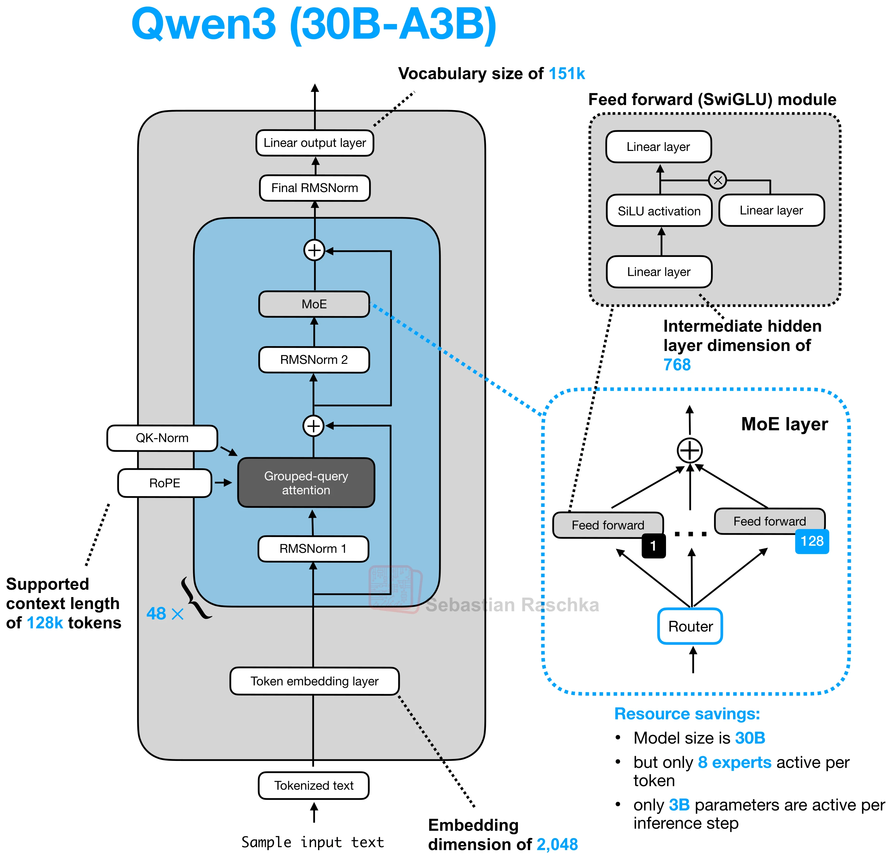

# MoE Kernel

用于单卡推理的 **Triton MoE 前向算子**。可以独立完成 Top-K 路由和专家计算，也可以通过插件接入 vLLM，对同一个模型比较原生路径与自定义算子。

[快速开始](#快速开始) · [实现原理](#实现原理) · [vLLM 集成](#vllm-集成) · [性能评测](#性能评测)

## 功能

- **完整的路由专家路径**：Softmax Top-K、路由对齐、两次间接寻址 GEMM、SwiGLU 和输出归约。
- **可独立调用**：`experts()` 接收已有路由，`moe()` 从 logits 开始；两者都复用预分配 workspace。
- **可分段评测**：从合成输入的算子微基准，到真实层采样与回放，再到整模型服务压测。

## 快速开始

先准备带 CUDA 的 PyTorch 和与之匹配的 Triton。在该环境里安装本项目：

```bash
pip install --no-deps --no-build-isolation .
```

下面是无需下载模型权重的 BF16 示例，输出为 `[M, H]`。专家权重布局是 `w13 [E, 2I, H]` 和 `w2 [E, H, I]`。

```python
import torch
from moe_kernel import MoEConfig, MoEWorkspace, moe

M, H, I, E, K = 8, 64, 32, 16, 4
device, dtype = torch.device("cuda"), torch.bfloat16
config = MoEConfig(hidden_dim=H, intermediate_dim=I, num_experts=E, top_k=K)

with torch.inference_mode():
    x = torch.randn((M, H), device=device, dtype=dtype)
    logits = torch.randn((M, E), device=device, dtype=dtype)
    w13 = torch.randn((E, 2 * I, H), device=device, dtype=dtype) / H**0.5
    w2 = torch.randn((E, H, I), device=device, dtype=dtype) / I**0.5

    workspace = MoEWorkspace()
    workspace.prepare(max_tokens=M, config=config, device=device, dtype=dtype)
    y = moe(x, logits, w13, w2, top_k=K, workspace=workspace)
    print(y.shape)  # torch.Size([8, 64])
```

已有 `topk_weights [M, K]` 和 `topk_ids [M, K]` 时，可以调用 `experts(x, w13, w2, topk_weights, topk_ids, workspace=workspace)`。两个入口都可以传入 `out=` 复用输出张量。

## 实现原理

```text
logits → Softmax Top-K → 按专家分组与行块对齐
                             ↓
hidden states ───────────→ GEMM1 → SwiGLU → GEMM2 并乘路由权重 → 沿 Top-K 求和
```

对齐阶段只重排路由索引，GEMM1 根据路由编号回读原始 token；GEMM2 按原路由顺序写回，归约无需再做一次逆重排。

<details>
<summary>架构示例：Qwen3-30B-A3B 中的 MoE 与 SwiGLU</summary>

<p align="center">
  
</p>

图：Sebastian Raschka，[LLM Architecture Gallery](https://sebastianraschka.com/llm-architecture-gallery/)。这张图用于说明路由专家的结构；下文整模型实验使用的是 Qwen3.5-35B-A3B，两者的专家配置不同。

</details>

## vLLM 集成

独立算子不依赖 vLLM。随项目提供的插件以 **vLLM 0.20.0** 为当前实验环境。插件保留模型原生的 Router Linear、shared expert 和最终输出合并，可通过 `MOE_KERNEL_MODE` 切换：

| 模式 | Top-K 路由 | 路由专家计算 |
| --- | --- | --- |
| `native` | vLLM | vLLM |
| `experts` | vLLM | 本项目 |
| `full` | 本项目 | 本项目 |

以下示例要求模型权重已在本地，使用单卡、未量化 BF16 和 eager 模式：

```bash
MOE_KERNEL_MODE=experts MOE_KERNEL_MAX_TOKENS=2048 \
vllm serve /path/to/Qwen3.5-35B-A3B \
  --tensor-parallel-size 1 --language-model-only \
  --enforce-eager --moe-backend triton --dtype bfloat16 \
  --max-model-len 8192 --max-num-seqs 8 --max-num-batched-tokens 2048
```

`MOE_KERNEL_MAX_TOKENS` 需要覆盖 vLLM 的批次 token 预算。首次验证时先跑 `native`，再用相同参数试 `experts` 和 `full`；自定义路径会在首次分配 workspace 时打印命中日志。

## 性能评测

| 工具 | 对比边界 |
| --- | --- |
| [算子微基准](benchmarks/bench_moe.py) | 固定路由或相同 logits 下的算子耗时，以及 padding 和输出误差 |
| [采样](benchmarks/capture_layer.py) / [单层回放](benchmarks/replay_layer.py) | 复用真实模型的一层权重和输入，对比 prefill / decode |
| [服务压测](benchmarks/bench_serve.py) | 三种接入模式的吞吐、TTFT、TPOT 与尾延迟 |

```bash
python -m benchmarks.bench_moe --backend both --boundary experts
python -m benchmarks.bench_serve --model /path/to/Qwen3.5-35B-A3B --plan
```

`--plan` 只输出压测命令，不启动服务。完整复现步骤和输出格式见 [Benchmark 指南](benchmarks/README.md)。目前已有独立算子的数值验证和小尺寸计时检查，尚未发布真实 Qwen3.5 的整模型性能结果。

## 支持范围

独立算子支持单张 NVIDIA CUDA GPU、BF16/FP16 专家权重、连续张量和前向推理。vLLM 自定义路径目前限定为单卡、未量化、标准 Softmax Top-K、无 bias 的 SwiGLU 和 eager 模式。量化、专家并行、LoRA、MTP 及 vLLM CUDA Graph 接入不在当前支持范围内。
